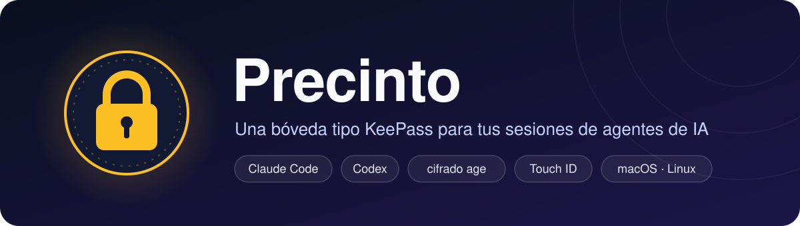
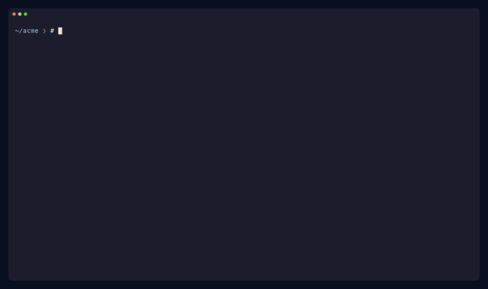
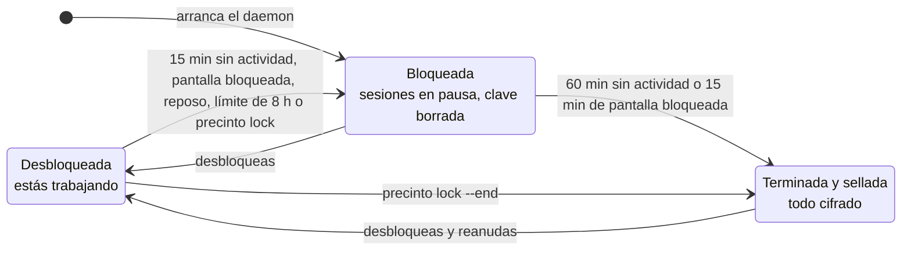
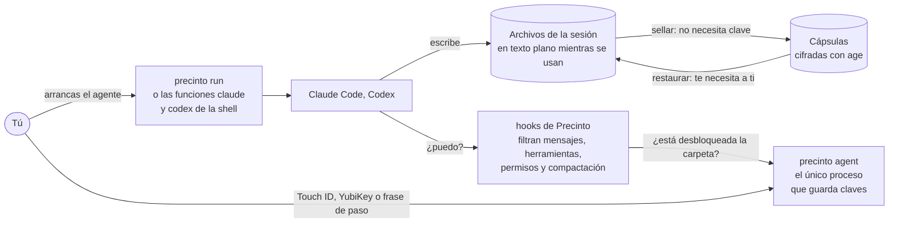
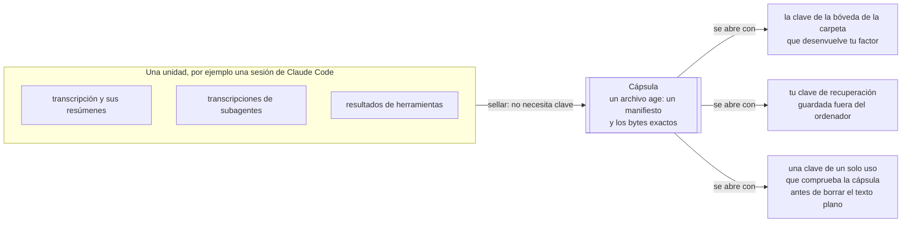
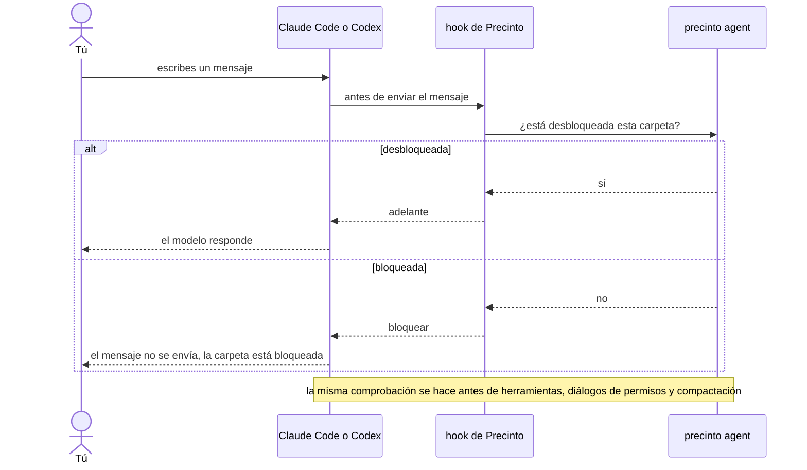

<p align="center">
  
</p>

<p align="center">
  <strong>Bloquea tus sesiones con agentes de IA cuando te vas, y te pide que estés presente antes de devolverlas.</strong>
  <br>
  <a href="README.md">English</a> · Español
</p>

> [!WARNING]
> **Versión preliminar, especificación v0.2.** Todos los comandos de esta página están implementados y probados, pero Precinto aún no se ha usado en el día a día, así que los detalles pueden cambiar. Primero macOS; Linux, en parte; Windows, a través de WSL 2 ([docs/WINDOWS.md](docs/WINDOWS.md), en inglés). Más en [Estado del proyecto](#estado-del-proyecto).

## ¿Qué es Precinto?

> **Precinto**: ligadura sellada que mantiene algo cerrado para que no se abra sino cuando y por quien corresponda.

Los agentes de programación con IA, como Claude Code y Codex (Precinto los llama *harnesses*), guardan en el disco, en texto plano, todo lo que se dice en cada sesión: conversaciones enteras, los archivos que leyó el agente, la salida de los comandos, resúmenes, memorias y planes. Cualquier programa que se ejecute con tu usuario puede leerlos.

Precinto es una **bóveda al estilo de KeePass para esas sesiones**. Tú decides qué carpetas importan. Cuando una de ellas se bloquea (porque has dejado de teclear, porque se ha bloqueado la pantalla o porque lo pides), Precinto sella en cápsulas cifradas con [age](https://age-encryption.org) las conversaciones, los resúmenes, las memorias, los planes, las salidas de herramientas y las notas que los agentes escribieron en ella. Para recuperarlas hace falta tu presencia (Touch ID o la contraseña del Mac, una llave de seguridad o una frase de paso), y todo vuelve a su sitio exactamente igual, byte a byte.

| Si conoces KeePass… | …Precinto funciona igual |
|---|---|
| una base de datos cifrada | una bóveda por cada carpeta que proteges |
| una contraseña maestra | tus *factores*: Touch ID (una clave del Secure Enclave), una llave de seguridad como una YubiKey o una frase de paso |
| se bloquea al cabo de un rato o al bloquear la pantalla | una carpeta se bloquea tras 15 minutos sin actividad tuya o al bloquear la pantalla |
| las entradas siguen cifradas en el disco | las sesiones se sellan en *cápsulas* cifradas |

## Cómo funciona, en una imagen

<p align="center">
  
</p>

- **Mientras trabajas no cambia nada.** Los archivos siguen en texto plano, justo donde los espera el agente, hasta que ya nada los escribe.
- **Sellar nunca necesita una clave.** Cualquier tarea de Precinto en segundo plano puede sellar; solo restaurar te necesita a ti.
- **Una bóveda por carpeta.** Desbloquear una carpeta nunca abre otra, de modo que un agente que trabaja en una carpeta no puede hacerse con la clave de otra sin ti.

## Míralo en acción

<p align="center">
  
</p>

Claude Code edita un archivo en `~/acme`, una carpeta protegida. Al salir, Precinto sella la sesión, y `precinto lock` borra la clave de la carpeta. `claude --continue` pide la frase de paso, restaura la sesión y Claude sigue donde lo dejó.

## Índice

- [Por qué importa](#por-qué-importa)
- [Cómo funciona](#cómo-funciona): [dos niveles de bloqueo](#dos-niveles-de-bloqueo), [qué bloquea una carpeta](#qué-bloquea-una-carpeta), [las piezas](#las-piezas), [cápsulas](#cápsulas), [hooks y lanzador](#hooks-y-lanzador)
- [Primeros pasos](#primeros-pasos)
- [Comandos habituales](#comandos-habituales)
- [La compactación, explicada](#la-compactación-explicada)
- [Herramientas compatibles](#herramientas-compatibles)
- [Qué protege Precinto y qué no](#qué-protege-precinto-y-qué-no)
- [Descarga](#descarga) · [Instalación desde el código fuente](#instalación-desde-el-código-fuente)
- [Configuración](#configuración)
- [Preguntas frecuentes](#preguntas-frecuentes)
- [Estado del proyecto](#estado-del-proyecto)
- [Documentación](#documentación) · [Licencia](#licencia)

## Por qué importa

Los agentes de programación guardan todo esto en texto plano en tu carpeta personal:

| Qué | Ejemplos |
|---|---|
| Transcripciones de las conversaciones | todo lo que escribiste o pegaste, los archivos que leyó el agente, la salida de los comandos |
| Datos derivados | resúmenes de compactación, memoria automática, planes, copias de los archivos editados, resultados de herramientas, listas de tareas, registros de depuración |
| Historial de mensajes | cada mensaje que escribiste, en un archivo aparte |
| Notas en tu proyecto | las notas y los planes en Markdown que el agente escribe junto a tu código |

Esos archivos pasan semanas en tu carpeta personal, protegidos solo por los permisos del sistema de archivos, así que cualquier programa que se ejecute con tu usuario puede leerlos: un *infostealer* que se ejecute una sola vez, el script de instalación de un paquete, otro agente que rebusque en tu carpeta personal, una copia de seguridad o una carpeta sincronizada.

Precinto mantiene esos archivos cifrados mientras nadie los usa, y te pide que estés presente antes de devolverlos.

## Cómo funciona

### Dos niveles de bloqueo



| Nivel | Qué ocurre |
|---|---|
| **Bloqueada** (bloqueo suave) | La clave de la carpeta se borra de la memoria al instante y sus sesiones quedan *en pausa*: los hooks de Precinto bloquean los mensajes nuevos (también los automáticos), deniegan las herramientas y los diálogos de permisos y detienen la compactación. Si la sesión se lanzó a través de Precinto, aparece además una pantalla de bloqueo que oculta la conversación y descarta lo que teclees; Intro desbloquea y Ctrl-D termina la sesión y la sella. Los archivos que ya no puede escribir ningún proceso se sellan. |
| **Terminada y sellada** (bloqueo fuerte) | Más tarde, las sesiones en pausa se *terminan*: Precinto cierra el harness de forma ordenada, limpia la terminal y sella todo lo que escribió la sesión. Este es el paso que convierte una sesión viva en datos cifrados. |

Los mensajes de la herramienta están en inglés y solo hablan de *locked* (bloqueada), *paused* (en pausa) y *ended and sealed* (terminada y sellada). Un turno que esté en marcha cuando se bloquea la carpeta puede terminar (durante un máximo de 30 minutos desde el bloqueo), salvo después de `precinto lock`, que lo frena todo en el acto a menos que añadas `--let-finish`. Las sesiones en segundo plano de Claude Code (`--bg` y la vista de agentes) nunca se terminan: siguen en pausa y `precinto status` las señala.

### Qué bloquea una carpeta

| Cuándo | Qué ocurre | Ajuste |
|---|---|---|
| 15 min sin actividad tuya en la carpeta | la carpeta se bloquea | `idle_soft` |
| 60 min sin actividad tuya | las sesiones en pausa se terminan y se sellan | `idle_hard` |
| se bloquea la pantalla | todas las carpetas se bloquean a la vez; con 15 min seguidos de pantalla bloqueada se terminan las sesiones inactivas (las ocupadas, a los 30 min). No con WSL 2, donde Precinto no ve la pantalla de bloqueo de Windows ([docs/WINDOWS.md](docs/WINDOWS.md), en inglés) | `lock_on_screen_lock`, `screen_lock_hard_after`, `busy_grace` |
| el ordenador entra en reposo | al despertar, todas las carpetas están bloqueadas | – |
| 8 h después de desbloquear | la carpeta se bloquea aunque sigas trabajando; avisa 10 min antes, y `precinto unlock --extend` vuelve a pedirte presencia | `max_unlock` (24 h como máximo) |
| `precinto lock` | se bloquean ya todas las carpetas (o una, con `--root DIR`); `--end` también termina las sesiones | – |
| arranca el daemon de Precinto | todas las bóvedas empiezan bloqueadas | – |

"Actividad" quiere decir actividad humana: teclas pulsadas en una sesión lanzada a través de Precinto, o un mensaje que Precinto considera escrito por ti. Con WSL 2, donde Precinto no ve tu teclado ni tu ratón en Windows, solo cuentan esas teclas. Los bucles, las tareas programadas y demás mensajes automáticos nunca mantienen una carpeta desbloqueada. Ningún evento del sistema operativo desbloquea jamás una carpeta.

### Las piezas



- **Carpetas protegidas, una bóveda cada una.** Una carpeta se protege con `precinto protect DIR`. Cada carpeta protegida tiene su propia bóveda: una identidad X25519 envuelta una vez por cada forma que tengas de desbloquearla (tus *factores*). Al desbloquear una carpeta solo se desenvuelve su clave, como si tuvieras una base de datos de KeePass por carpeta, de modo que un agente que trabaja en una carpeta no puede hacerse con la clave de otra sin ti. Una bóveda aparte, `global`, guarda los pocos almacenes del harness que no pertenecen a ninguna carpeta.
- **El daemon.** `precinto agent` es un proceso por usuario que arranca solo cuando hace falta. Es el único que desenvuelve las claves de las bóvedas: las guarda en memoria bloqueada, nunca las escribe en disco y solo entrega claves de cápsulas concretas, solo al mismo ejecutable `precinto`, solo para cápsulas que figuran en su registro y solo mientras todas las carpetas de esa cápsula estén desbloqueadas.

### Cápsulas



Precinto agrupa los archivos que escribe cada harness en *unidades*: una sesión de Claude Code con sus subagentes y sus resultados de herramientas, la memoria automática de un proyecto, un plan, las líneas del historial que corresponden a una carpeta, el directorio de Codex de una carpeta, una nota en Markdown. Al sellar una unidad se escribe una *cápsula*: un único archivo age con un manifiesto y los bytes exactos de cada archivo. Cada cápsula se cifra para tres claves: la bóveda de la carpeta, tu clave de recuperación y una clave de un solo uso con la que Precinto descifra y comprueba la cápsula antes de borrar el texto plano.

- Las cápsulas viven en el directorio de Precinto (`~/Library/Application Support/precinto` en macOS; `$XDG_DATA_HOME/precinto`, por defecto `~/.local/share/precinto`, en Linux), nunca entre los archivos del harness ni en tu proyecto. De una nota sellada solo queda un pequeño marcador de texto, `NOMBRE.md.precinto`, donde estaba.
- Una cápsula nunca se sobrescribe. Cada nuevo sellado añade una *generación*, y las antiguas solo desaparecen cuando las borras tú (`precinto prune`, `precinto forget`).
- Solo se restauran las cápsulas que selló el propio Precinto, anotadas en su registro de cápsulas, y solo en los lugares que admite su tipo de unidad.
- **Sellar nunca necesita una clave.** Cualquier tarea de Precinto en segundo plano (un barrido, el final de una sesión, un bloqueo) puede sellar; solo restaurar te necesita a ti.

### Hooks y lanzador



Precinto se conecta a cada harness de dos maneras:

- **Hooks**, de un plugin que instala `precinto integrate`. Antes de cada mensaje, llamada a herramienta, diálogo de permisos o compactación, el harness pregunta a Precinto, que responde en milisegundos con el estado del daemon. En las sesiones de carpetas protegidas, cualquier fallo bloquea (*fail closed*); fuera de ellas, Precinto no interfiere. Los hooks también anotan qué archivos ha tocado cada sesión y la ponen en cola para sellarla cuando termina.
- **El lanzador** (el *wrapper*): `precinto run`, o las funciones `claude` y `codex` que instala `precinto shell-init`. Pide el desbloqueo antes de arrancar el harness, restaura la sesión que vas a reanudar antes de que el harness la busque, dibuja la pantalla de bloqueo, termina la sesión limpiamente cuando toca y la sella al salir. La integración con la shell, además, ofrece desbloquear cuando entras con `cd` en una carpeta bloqueada.

> [!IMPORTANT]
> Los hooks son una barrera, no una frontera de seguridad: un harness se puede arrancar con los hooks desactivados. Lo que protege tus datos es el cifrado en reposo, unas claves que solo custodia el daemon y unos barridos que no necesitan clave. Los detalles están en [docs/THREAT_MODEL.md](docs/THREAT_MODEL.md) (en inglés).

## Primeros pasos

Ejecuta estos comandos tú, en tu propia terminal, no dentro de la sesión de un agente: Precinto se niega a mostrar la clave de recuperación o a cambiar tus factores donde un agente pueda leerlos.

```sh
precinto init                       # 1. bóvedas, factor de desbloqueo y clave de recuperación (una sola vez)
precinto protect ~/work/acme        # 2. proteger una carpeta
precinto shell-init zsh --install   # 3. integración con la shell (o bash, fish)
precinto integrate claude-code      # 4. instalar los hooks
precinto integrate codex

cd ~/work/acme                      # 5. trabajar como siempre
claude                              #    pasa por Precinto gracias al paso 3
precinto run codex                  #    la forma explícita, sin integración con la shell

precinto status                     # 6. qué está bloqueado, en marcha o todavía sin cifrar
precinto lock                       #    bloquear ya todas las carpetas
precinto lock --end                 #    ...y además terminar y sellar sus sesiones
precinto unlock                     #    desbloquear la carpeta en la que estás
precinto unlock --root ~/work/acme  #    o indicarla
```

<details>
<summary><strong>Qué hace cada paso</strong></summary>

1. **`precinto init`** crea tus bóvedas y tus factores. En macOS el factor por defecto es una clave del Secure Enclave creada con `age-plugin-se`, que se desbloquea con Touch ID o, si no tienes Touch ID emparejado, con la contraseña del Mac. En Linux te pide una frase de paso (al menos 12 caracteres; puede proponerte una de 7 palabras, que te muestra tal como debes escribirla, con sus guiones). Dentro de tmux, screen o SSH, donde el diálogo de macOS no puede aparecer, ofrece además una frase de paso como segundo factor. Después te muestra la clave de recuperación una sola vez, en una pantalla limpia, y te pide que escribas sus 4 últimos caracteres (con `--recovery-out ARCHIVO`, en cambio, la guarda en un archivo). Hasta ese momento no se configura nada: si te detienes en esa pantalla, vuelve a ejecutar `precinto init` más tarde y obtendrás una clave nueva. En macOS ofrece también instalar el servicio de resellado en segundo plano. Comprueba la clave de recuperación con `precinto recover --verify`.
2. **`precinto protect DIR`** crea la bóveda de la carpeta y la registra. Opciones: `--md ledger|all|off` (qué Markdown sellar; por defecto, solo el que escribió un agente), `--on-enter prompt|notify|off`, `--harness LISTA` (los harnesses que Precinto gestiona en la carpeta; por defecto, `claude-code,codex`) y `--claude-settings` (consulta [las preguntas frecuentes](#preguntas-frecuentes)). Si Codex está instalado, pregunta además si Precinto debe guardar para esa carpeta un historial de Codex aparte y sellado. Si respondes que no, la carpeta no gestiona Codex: allí `precinto run codex` te vuelve a hacer la misma pregunta y solo arranca Codex cuando respondes que sí. `protect` también ofrece añadir `*.md.precinto` al `.git/info/exclude` local del repositorio, que nunca se incluye en un commit. Las sesiones de Claude Code que tuviste en esa carpeta antes de protegerla aparecen en `precinto status`; séllalas con `precinto seal --adopt`. Las conversaciones anteriores de Codex se quedan en tu propio directorio de Codex, que Precinto no sella.
3. **`precinto shell-init zsh|bash|fish`** imprime funciones de shell para tus harnesses y un hook que ofrece desbloquear cuando entras con `cd` en una carpeta bloqueada (Intro desbloquea; cualquier otra tecla lo deja estar). El hook pregunta como mucho una vez por bloqueo en cada shell, y nunca en una subshell ni dentro de una sesión que haya arrancado Precinto. `--install` te pregunta primero y luego añade exactamente una línea, una sola vez, al archivo de arranque de tu shell: `eval "$(precinto shell-init zsh)"` a `~/.zshrc`, `eval "$(precinto shell-init bash)"` a `~/.bashrc` o `precinto shell-init fish | source` a `~/.config/fish/config.fish`. También puedes añadir esa misma línea a mano. En macOS, Terminal arranca bash como shell de inicio de sesión, que solo lee `~/.bashrc` si tu `~/.bash_profile` lo carga.
4. **`precinto integrate HARNESS`** instala el plugin de Precinto con los propios comandos de plugins del harness. El plugin viene dentro del propio binario `precinto`, así que no se descarga nada: integrate lo escribe en la carpeta `marketplace` del directorio de Precinto y añade esa carpeta al harness como un *marketplace* local (`claude plugin marketplace add …` y después `claude plugin install precinto@precinto`; en Codex, `codex plugin marketplace add …` y `codex plugin add precinto@precinto`). `--print` enseña esos comandos sin cambiar nada. Si alguno falla, la configuración de Precinto se queda como estaba e integrate imprime los comandos para que los ejecutes tú y leas el error completo. Rechaza las versiones de Claude Code anteriores a la 2.1.295 (actualízalo con `claude update`). Codex solo ejecuta los hooks de un plugin cuando confías en ellos, y Precinto nunca lo hace por ti: ejecuta `/hooks` en Codex y marca Precinto como de confianza. Codex 0.154 guarda esa confianza en el `config.toml` del directorio de Codex con el que se ejecuta, esté donde esté instalado el plugin, así que basta con que confíes en Precinto una vez en tu propio directorio de Codex (arranca Codex en una carpeta que no esté protegida): todas las carpetas protegidas cuyo directorio de Codex cree Precinto a partir de entonces empiezan con esa confianza. Para una carpeta cuyo directorio de Codex ya existe, ejecuta `precinto codex sync-config --root DIR` o vuelve a dar la confianza en Codex arrancado en esa carpeta. Los hooks de Codex son opcionales: sin ellos, el historial de Codex se sella igualmente al salir, pero los mensajes no se pausan mientras la carpeta está bloqueada.
5. **`precinto run HARNESS [ARGS]`** (o la función de la shell) comprueba que la carpeta esté desbloqueada y, si no lo está, te lo pide; luego restaura lo que necesita la sesión, arranca el harness y sella la sesión al salir. Las sesiones que nunca tocan una carpeta protegida quedan al margen.
6. **`status`, `lock` y `unlock`**: consulta [Comandos habituales](#comandos-habituales). `precinto unlock` sin opciones desbloquea la carpeta en la que estás. Fuera de cualquier carpeta protegida, en una terminal, desbloquea la única carpeta bloqueada o, si hay varias, las enumera y te pide que elijas una por su número (o todas, después de escribir `unlock`). Sin terminal, solo puede desbloquear la carpeta del directorio actual. Si cancelas un desbloqueo o te equivocas al escribir, Precinto espera 30 segundos antes de volver a pedirlo para esa carpeta (`prompt_backoff`) y te avisa de ello. Tras un desbloqueo, Precinto restaura en segundo plano hasta cinco de las sesiones más recientes de la carpeta, sus notas y su historial de mensajes.

</details>

## Comandos habituales

| Comando | Qué hace |
|---|---|
| `precinto status [--json] [--check]` | las carpetas y su estado, las sesiones, los archivos todavía sin cifrar y el motivo, el estado de los hooks y lo que requiere atención (cada aviso indica el comando que lo resuelve). Con `--check` sale con código 3 si alguna carpeta bloqueada conserva archivos sin cifrar, y con código 1 si no puede comprobarlo (por ejemplo, mientras `config.toml` tenga un error). |
| `precinto unlock [--root DIR \| --all \| --global] [--for DURACIÓN] [--factor NOMBRE] [--extend]` | desbloquear con tu presencia: la carpeta en la que estás o la que indiques; fuera de cualquier carpeta, la única bloqueada o la que elijas. `--all` la pide una vez por carpeta, tras una confirmación escrita; `--global` desbloquea la bóveda `global` (entonces no se restaura nada: ejecuta `precinto restore --global`). Desbloquear una carpeta la desbloquea en todas las terminales. |
| `precinto lock [--root DIR \| --all] [--end \| --hard] [--force] [--let-finish]` | bloquear ya (por defecto, todas las carpetas, aunque `config.toml` tenga un error). `--end` (o `--hard`) termina también las sesiones; `--force` no espera a que acabe una compactación en curso. |
| `precinto run [--harness H] [--no-pty] -- CMD [ARGS]` | ejecutar un harness a través de Precinto |
| `precinto resume [ID \| --last \| --pick]` | restaurar una sesión de Claude Code y reanudarla |
| `precinto restore [--root DIR] [--session ID] [--recent N] [--all] [--md] [--history]` | restaurar a mano; sin ninguna opción de selección, restaura lo mismo que un desbloqueo |
| `precinto restore --global [--harness H]` | tras `precinto unlock --global`: restaurar lo que no pertenece a ninguna carpeta (los almacenes globales de Claude Code y las unidades de los harnesses experimentales) |
| `precinto seal [--adopt] [--dry-run]` | sellar ahora; nunca necesita clave. `--dry-run` dice qué sellaría y no sella nada |
| `precinto ls [--root DIR] [--conflicts]` | listar las unidades y notas selladas |
| `precinto open ARCHIVO.md.precinto`, `precinto cat ARCHIVO.md.precinto` | restaurar una nota sellada en su sitio, o mostrarla |
| `precinto resolve ARCHIVO [--keep capsule\|plaintext]` | resolver un conflicto entre la versión sellada y la actual |
| `precinto prune`, `precinto forget ARCHIVO\|UNIDAD` | borrar generaciones antiguas, o las copias selladas de una unidad, tras una confirmación escrita |
| `precinto doctor [--leaks] [--json] [HARNESS]` | comprobaciones de solo lectura; `--leaks` busca copias fuera del alcance de Precinto y `--json` imprime los resultados en JSON |
| `precinto service install\|uninstall\|status` | macOS: resellado en segundo plano cada 10 minutos (nunca guarda claves) |
| `precinto agent --restart`, `precinto agent --stop` | reiniciar el agente en segundo plano (después de actualizar) o detenerlo: se borran sus claves y todas las carpetas se bloquean |
| `precinto factor list\|add\|remove\|test\|repin`, `precinto recover --verify` | gestionar los factores (`repin` acepta un plugin de age actualizado; consulta [las preguntas frecuentes](#preguntas-frecuentes)); comprobar la clave de recuperación |

## La compactación, explicada

Cuando una conversación ya no cabe en la ventana de contexto del modelo, el harness resume su parte más antigua: eso es la *compactación*. La compactación no borra nada: Claude Code y Codex añaden el resumen al final de la **misma** transcripción, así que el resumen se sella junto con la sesión.

| | Carpeta desbloqueada | Carpeta bloqueada | Sesión terminada |
|---|---|---|---|
| `/compact` y la compactación automática | funcionan con normalidad | en pausa; un turno que ya estaba en marcha puede terminar, salvo después de `precinto lock` | – |
| Los resúmenes en segundo plano de Claude Code (compactación por inactividad, resumen de ausencia, compactación precalculada) | desactivados en las sesiones que arranca Precinto | desactivados en las sesiones que arranca Precinto; además, los hooks bloquean la compactación por inactividad | – |
| La transcripción y sus resúmenes | texto plano | texto plano (la sesión sigue viva) | **sellados** |

Cuando Precinto arranca Claude Code en una carpeta protegida, desactiva esos resúmenes en segundo plano, porque añadirían texto plano nuevo a una sesión que todavía no se puede sellar. Lo que de verdad protege una conversación compactada es **terminar la sesión**: los temporizadores que terminan las sesiones en pausa (`idle_hard`, `screen_lock_hard_after`) o `precinto lock --end` marcan cuánto tiempo sigue siendo legible. Más detalles en [docs/COMPACTION.md](docs/COMPACTION.md) (en inglés).

## Herramientas compatibles

| Harness | Soporte | Cómo se conecta Precinto |
|---|---|---|
| Claude Code | **Compatible.** Verificado con la 2.1.329; requiere la 2.1.295 o posterior | hooks del plugin (`precinto integrate claude-code`) y el lanzador |
| Codex CLI | **Compatible**, 0.154.x (verificado sobre su código fuente; las demás versiones muestran un aviso hasta que se verifiquen) | el lanzador da a cada carpeta protegida que gestiona Codex (Precinto lo pregunta una vez por carpeta) su propio directorio de Codex sellado; los hooks son opcionales y exigen que confíes en ellos desde Codex: si confías una vez en tu propio directorio de Codex, quedan aprobados en todas las carpetas cuyo directorio de Codex se cree después |
| Factory Droid, Cursor, GitHub Copilot CLI | **Experimental**, sin verificar | hooks del mismo plugin, que solo se activan con `precinto integrate <host> --experimental` |
| Gemini CLI, Kimi Code, Qwen Code, OpenCode | **Experimental** | solo el lanzador, con un inventario declarativo; el sellado es manual (`precinto seal --dormant <id> --experimental`), en la bóveda `global`, y no se restaura nada automáticamente: ejecuta `precinto restore --global --harness <id>` después de `precinto unlock --global` |

En Windows, Claude Code y Codex tienen que ejecutarse dentro de la misma distribución de WSL 2 que Precinto: Precinto rechaza un `claude` o un `codex` que se ejecutaría como programa de Windows, y no protege Claude Code ni Codex para Windows, ni la app de escritorio de Claude. No instales el plugin de Precinto en Claude Code para Windows. Consulta [docs/WINDOWS.md](docs/WINDOWS.md) (en inglés).

Qué se sella con cada harness, cómo encajan los hooks y el lanzador, y las salvedades conocidas: [docs/HARNESSES.md](docs/HARNESSES.md) (en inglés).

## Qué protege Precinto y qué no

Precinto acorta el tiempo que tus sesiones pasan en el disco como texto plano, pero no vuelve secreta una sesión que está en marcha.

| Situación | Resultado |
|---|---|
| Un programa que se ejecuta una vez con tu usuario (un *infostealer*, un script de instalación) cuando tus sesiones ya están selladas | ✅ para él, las sesiones selladas solo son datos cifrados |
| Una copia de seguridad o una carpeta sincronizada, después de sellar | ✅ copia cápsulas, no conversaciones |
| Un agente que trabaja en otra carpeta protegida | ✅ no puede hacerse con la clave de esta carpeta sin ti |
| Un agente manipulado mediante inyección de instrucciones que intenta desbloquear o leer archivos sellados | ✅ se le rechaza, o aparece un diálogo de desbloqueo que solo tú puedes aprobar |
| Una sesión en marcha o una carpeta desbloqueada | ❌ texto plano, al alcance de cualquier programa que se ejecute con tu usuario |
| Malware que sigue ejecutándose con tu usuario | ❌ lee lo que esté desbloqueado y puede capturar la clave de una carpeta la próxima vez que la desbloquees |
| Copias en otros sitios: proveedores de los modelos, sincronización en la nube, Spotlight, Time Machine con la carpeta desbloqueada, el historial de la terminal… | ❌ fuera del alcance de Precinto; `precinto doctor --leaks` informa de lo que encuentra |
| Texto plano borrado en discos SSD | ❌ activa FileVault, el cifrado de disco en Linux o BitLocker con WSL 2 |
| Con WSL 2, cualquier programa de Windows que se ejecute con tu usuario | ❌ puede abrir la distribución como root (`wsl -u root`, sin contraseña) y leer las claves de las carpetas desbloqueadas; las bloqueadas siguen selladas |
| Con WSL 2, Claude Code, Codex o un editor que se ejecutan en Windows | ❌ fuera del alcance de Precinto, que se ejecuta dentro de la distribución: ejecútalos ahí |
| Con WSL 2, bloquear Windows (Win+L) | ❌ Precinto no lo ve: ejecuta `precinto lock`; los temporizadores de inactividad siguen bloqueando y sellando |

<details>
<summary><strong>La lista completa de límites</strong></summary>

- **Malware que sigue ejecutándose con tu usuario.** Puede leer todo lo que esté desbloqueado o en uso, y capturar la clave de una carpeta la próxima vez que la desbloquees. Tener bóvedas separadas lo limita a las carpetas que desbloquees.
- **Sesiones en uso.** Los archivos de una sesión en marcha y los de una carpeta desbloqueada están en texto plano, en el disco y en memoria, al alcance de cualquier programa que se ejecute con tu usuario.
- **Copias en otros sitios.** Lo que guarden los proveedores de los modelos, la sincronización en la nube de un harness, y las copias hechas antes de proteger una carpeta o fuera del inventario de Precinto: el índice de Spotlight, las instantáneas y copias de Time Machine tomadas con la carpeta desbloqueada, el historial y la restauración de sesiones de la terminal (iTerm2, Terminal.app, tmux-resurrect, Windows Terminal), el portapapeles y Handoff, el historial de notificaciones, los historiales de los editores, los objetos de git, los almacenes de la app de escritorio de Claude y los de los propios servidores MCP. `precinto doctor --leaks` informa de lo que encuentra.
- **Texto plano borrado en discos SSD.** Pueden sobrevivir bloques antiguos después de sellar y borrar un archivo. Activa FileVault, el cifrado de disco en Linux o BitLocker con WSL 2.
- **Mensajes escritos con la carpeta bloqueada.** No llegan al modelo, pero el harness puede guardarlos igualmente en la transcripción y en su historial de mensajes. La copia de la transcripción se sella con la sesión; la línea del historial espera a la siguiente rotación, que exige cerrar todos los procesos de Claude Code. No escribas secretos en una sesión bloqueada.
- **Sesiones arrancadas sin el lanzador.** En la terminal de un IDE, en una app de escritorio o con `command claude`, un bloqueo solo detiene al modelo: la conversación sigue a la vista y los comandos locales como `/export` o `/copy` siguen funcionando. Si esa sesión tampoco tiene hooks que funcionen (plugin desactivado, `--bare`, `disableAllHooks`), una sesión interactiva de Claude Code se termina al bloquear y cualquier otra solo se notifica.
- **Hooks que dejan pasar cuando fallan.** Codex 0.154 deja seguir una acción cuando un hook agota su tiempo, y no ejecuta ningún hook en el que no hayas confiado. Claude Code 2.1.329 tiene una vía, condicionada por un indicador interno, que puede compactar pese al bloqueo de Precinto. Copilot CLI no puede bloquear mensajes. Si el binario `precinto` falla, su shim solo bloquea las sesiones cuyo directorio de trabajo o de proyecto está dentro de una carpeta protegida.
- **Codex arrancado sin Precinto** en una carpeta protegida escribe en tu propio directorio de Codex, que Precinto nunca sella; `status` y `doctor` cuentan esas conversaciones. Si marcaste como de confianza los hooks de Precinto en tu propio directorio de Codex, bloquean esa sesión en las carpetas que gestionan Codex.
- **Metadatos.** Las rutas de las carpetas, cuántas sesiones hay y el tamaño y la fecha de las cápsulas se pueden leer sin clave. Los títulos y el contenido, no.
- **Un programa decidido que se ejecuta con tu usuario.** La detección de agentes y las confirmaciones escritas frenan los accidentes y a los agentes manipulados mediante inyección de instrucciones, no a un programa que se haga pasar por una terminal. Precinto también confía en tu `$HOME`, en el `PATH` de tu shell y en su propio binario. En Linux, Precinto solo puede comprobar su daemon por el usuario, por quién tiene su archivo de bloqueo y por el nombre del proceso, así que un programa así podría suplantar al daemon.
- **Windows a través de WSL 2.** La frontera es la cuenta de Windows: cualquier programa de Windows que se ejecute con tu usuario puede abrir la distribución como root sin contraseña (`wsl -u root`), y también puede hacerlo un programa de dentro: mediante `wsl.exe` mientras esté activada la interoperabilidad con Windows, y si no, más tarde, con un archivo que deje en una unidad de Windows para que Windows lo ejecute con tu usuario; root puede leer de la memoria del daemon las claves de las carpetas desbloqueadas. Los programas que se ejecutan en Windows (Claude Code o Codex para Windows, la app de escritorio de Claude, los editores de Windows) quedan fuera del alcance de Precinto. Bloquear Windows no bloquea las carpetas, el desbloqueo se hace en una terminal, y el disco virtual de la distribución, el archivo de intercambio de WSL y el de hibernación de Windows están en la unidad de Windows. Detalles y ajustes recomendados, en inglés: [docs/WINDOWS.md](docs/WINDOWS.md).

Y en la v0.2, además: una sesión grande se vuelve a cifrar entera cada vez que cambia; las líneas del historial de mensajes solo se sellan cuando no hay ningún proceso de Claude Code en marcha, y la memoria del proyecto, cuando ninguno trabaja en el repositorio de esa carpeta. La lista completa, con sus motivos, está en [docs/THREAT_MODEL.md](docs/THREAT_MODEL.md) (en inglés).

</details>

## Descarga

En la página de [Releases](https://github.com/Neorichi/precinto/releases) están los archivos de la versión preliminar: uno para macOS (un único binario para Apple silicon e Intel) y dos para Linux (amd64 y arm64). Cada uno es una carpeta con el binario `precinto`, `LICENSE`, `NOTICE` y `README.md`, y un archivo `SHA256SUMS` recoge sus sumas. El binario de macOS solo lleva una firma ad hoc, sin Developer ID ni notarización: comprueba la suma antes de instalar y permite el binario una vez como explican las notas de la versión. En macOS, el método de desbloqueo por defecto, Touch ID, necesita además `age-plugin-se` ([Instalación desde el código fuente](#instalación-desde-el-código-fuente)); sin él, ejecuta `precinto init --factor passphrase`. Windows no tiene descarga propia: dentro de WSL 2 se usa la de Linux ([docs/WINDOWS.md](docs/WINDOWS.md)).

```sh
p=darwin_universal                                 # en Linux: p=linux_amd64 o p=linux_arm64
grep "_$p.tar.gz" SHA256SUMS | shasum -a 256 -c -   # en Linux: ... | sha256sum -c -
tar -xzf precinto_*_$p.tar.gz
sudo install -m 0755 precinto_*_$p/precinto /usr/local/bin/precinto
precinto version
```

## Instalación desde el código fuente

| | Necesitas |
|---|---|
| En todos los sistemas | Go 1.21 o posterior, `make` y `git` |
| macOS | `age-plugin-se` para el factor por defecto (`brew install age-plugin-se`; revisa qué versiones de macOS admite); opcional: `pinentry-mac` |
| Linux | opcionales: `pinentry-gnome3` (de los paquetes de tu distribución) y `age-plugin-yubikey` si quieres usar una YubiKey |
| Windows (WSL 2) | una distribución de WSL 2, como Ubuntu 24.04, con Go, `make` y `git` instalados dentro: Precinto, Claude Code y Codex se ejecutan todos ahí, y tus proyectos se quedan en su sistema de archivos de Linux, no en `/mnt/c`. Consulta [docs/WINDOWS.md](docs/WINDOWS.md) (en inglés) |

```sh
git clone https://github.com/Neorichi/precinto.git
cd precinto
make build                     # genera bin/precinto (sin CGO, con -trimpath)
sudo install -m 0755 bin/precinto /usr/local/bin/precinto   # o cualquier directorio de tu PATH
precinto version
```

Con Go instalado, `go install github.com/Neorichi/precinto/cmd/precinto@latest` también compila e instala la última etiqueta en `$(go env GOPATH)/bin`.

Cada vez que sustituyas el binario, ejecuta `precinto agent --restart`: los clientes se niegan a hablar con un daemon que ejecuta otro binario. Detiene el agente en marcha, arranca el nuevo en segundo plano y te devuelve la terminal. `precinto agent --stop` detiene el agente: se borran sus claves, así que todas las carpetas quedan bloqueadas hasta que algo lo vuelva a arrancar (cualquier desbloqueo lo hace).

<details>
<summary><strong>Más sobre la compilación</strong></summary>

- `go.mod` fija `toolchain go1.26.11`, así que, con `GOTOOLCHAIN=auto` (el valor por defecto de Go; algunas distribuciones lo cambian a `local`, y allí hay que usar `GOTOOLCHAIN=auto make build`), el comando go descarga y usa Go 1.26.11 la primera vez que compilas (para eso necesita acceso de red al proxy de módulos de Go).
- `make` usa el primer `go` de tu `PATH` que funcione; con `make GO=/ruta/a/go` eliges otro.
- Hay archivos de la versión preliminar en Releases ([Descarga](#descarga)); su binario de macOS solo lleva una firma ad hoc (sin Developer ID ni notarización), y aún no hay fórmula de Homebrew (está prevista; puede cambiar). Una compilación propia no está firmada ni notarizada, así que en macOS `precinto doctor` la señala como no endurecida (*unhardened build*); es lo normal.
- `pinentry-mac` permite desbloquear con una frase de paso o con un plugin desde dentro de un harness. Precinto solo ejecuta un pinentry instalado en una ubicación que solo root puede cambiar (`/usr/bin`, `/opt/local/bin` de MacPorts, GPG Suite), nunca desde el prefijo de Homebrew, en el que puedes escribir tú y, por tanto, cualquier programa que se ejecute con tu usuario; si solo tienes el `pinentry-mac` de Homebrew, desbloquea con la frase de paso en una terminal.

</details>

## Configuración

La configuración vive en `config.toml`, dentro del directorio de Precinto. La tabla `[policy]` reúne los temporizadores y las opciones descritos más arriba, por ejemplo:

```toml
[policy]
idle_soft = "15m"              # bloquear tras este tiempo de inactividad
idle_hard = "60m"              # terminar las sesiones en pausa ("0" = nunca)
max_unlock = "8h"              # límite absoluto de un desbloqueo (24h como máximo)
lock_on_screen_lock = true
screen_lock_hard_after = "15m"
on_enter = "prompt"            # ofrecer el desbloqueo al entrar con cd en una carpeta bloqueada
unlock_on_prompt = false       # que un mensaje escrito en una sesión bloqueada abra el diálogo de desbloqueo
min_free = "2GiB"              # espacio libre que Precinto deja siempre en el disco al sellar o restaurar
```

`min_free` admite un tamaño como `"512MiB"` o `"4GiB"` (unidades binarias; como mínimo `512MiB`). Si sellar una sesión dejara menos espacio libre que eso, Precinto deja la sesión como está y avisa de que el disco está lleno (*disk full*) en vez de llenarlo; el mismo límite vale para las restauraciones.

> [!NOTE]
> Los cambios que **rebajan** la protección (quitar una carpeta o un harness, alargar un temporizador, desactivar un disparador, sellar menos notas, relajar las peticiones de desbloqueo, bajar `min_free`) quedan en espera hasta que, en tu próximo desbloqueo desde una terminal, Precinto te los enseña y los confirmas. Los cambios más estrictos se aplican al momento. Así, ni otro programa que se ejecute con tu usuario ni un agente pueden rebajar la protección sin que te enteres.

<details>
<summary><strong>Errores en config.toml, configuración firmada y otros detalles</strong></summary>

Si `config.toml` tiene un error (un tamaño escrito `"2GB"` en vez de `"2GiB"`, una duración sin su unidad, una clave mal escrita), los comandos que lo leen se detienen e indican la línea, la clave y qué está mal, con una pista: la unidad que debes usar, los valores admitidos o, si la clave está mal escrita, la que probablemente querías poner. `precinto lock` sigue bloqueando todas las carpetas, y los sellados de las carpetas bloqueadas se siguen haciendo, con la última configuración que confirmaste. `precinto status` y `precinto doctor` muestran el error y siguen revisando tus carpetas con la última configuración que confirmaste; `precinto status --check` no da el visto bueno hasta que corrijas el archivo. Mientras tanto, el agente de Precinto en segundo plano mantiene la configuración que cargó por última vez.

Mientras no confirmes un cambio que rebaja la protección, no se aplica: una carpeta que hayas quitado sigue protegida (se sigue bloqueando y sellando, y `precinto unlock` dentro de ella te enseña el cambio). Precinto firma la configuración que confirmas con la clave de una carpeta que siga protegida, o con la de la bóveda global si no queda ninguna; si ninguna está desbloqueada, te pide que desbloquees una. Una configuración que no protege ninguna carpeta solo lleva la firma de la bóveda global, y esa firma únicamente la comprueba `precinto unlock --global`: mientras sea la última que confirmaste, el primer desbloqueo de una carpeta enumera también las carpetas cuya bóveda conserva Precinto pero que `config.toml` no protege, y `precinto status` y `precinto doctor` las nombran (`unprotected-folders`). Si no dejaste de protegerlas tú, ejecuta `precinto unlock --global`, que comprueba esa configuración. Cuando el agente en segundo plano de Precinto se reinicia, el primer desbloqueo de una carpeta para la que tu configuración guardada aún no está firmada puede enseñarte tus ajustes personalizados y pedirte que los confirmes una vez. `unlock_on_prompt` viene desactivado; está previsto activarlo cuando su prueba de extremo a extremo pase en la versión de Claude Code de referencia. `prompt_rate_per_minute` tiene que ser al menos 1: las peticiones de desbloqueo no se pueden desactivar, porque Precinto ya no podría desbloquear nunca una carpeta.

</details>

## Preguntas frecuentes

<details>
<summary><strong>¿Precinto cifra mis archivos mientras trabajo?</strong></summary>

No. Mientras una carpeta está desbloqueada, o mientras una sesión puede seguir escribiendo sus archivos, estos siguen en texto plano, justo donde el harness los espera. Precinto nunca sella, mueve ni borra un archivo que un proceso pueda estar escribiendo: los harnesses van añadiendo líneas a sus transcripciones, y una transcripción que se aparta con la sesión en marcha pierde historial. Los archivos se sellan cuando la carpeta está bloqueada y ya nada los escribe, y como muy tarde cuando termina la sesión.

</details>

<details>
<summary><strong>¿Qué pasa cuando el agente compacta la conversación?</strong></summary>

El resumen va a la misma transcripción y se sella con la sesión; con la carpeta bloqueada, la compactación queda en pausa. Consulta [La compactación, explicada](#la-compactación-explicada) y [docs/COMPACTION.md](docs/COMPACTION.md) (en inglés).

</details>

<details>
<summary><strong>¿Cómo reanudo una sesión sellada?</strong></summary>

Como siempre, pero a través de Precinto: con la integración de la shell, `claude --resume ID`, `claude --continue` y el selector de `claude --resume` funcionan sin más, porque Precinto restaura la transcripción antes de que arranque Claude Code (que la busca antes de que se ejecute ningún hook). Al desbloquear, las cinco sesiones más recientes de la carpeta vuelven en segundo plano, de modo que el selector de Claude Code las muestra; para las más antiguas usa `precinto resume --pick`, `precinto resume ID` o `precinto resume --last`. En Codex, todo el directorio de Codex de la carpeta se restaura antes de arrancar, así que `codex resume` también funciona a través de Precinto.

Si arrancas un harness sin Precinto y la sesión está sellada, el harness no la encontrará; en ese caso Precinto te dice cómo reanudarla. Las restauraciones automáticas se saltan las sesiones de Claude Code que rozan el límite `cleanupPeriodDays` del propio Claude Code; si reanudas una de ellas a propósito, Precinto la restaura con una fecha reciente para que Claude Code no la borre al arrancar. La copia sellada se conserva en cualquier caso.

</details>

<details>
<summary><strong>¿Puedo tener varias sesiones a la vez?</strong></summary>

Sí. Todas las sesiones de una carpeta comparten su bloqueo: un desbloqueo abre la carpeta en todas las terminales y un bloqueo las pausa todas. Cada sesión se sella cuando termina.

- Si abres una sesión que ya está en marcha en otra terminal, Precinto te propone abrir una copia con `--fork-session`, porque dos procesos escribiendo la misma transcripción pueden perder mensajes.
- Una sesión que trabaja en dos carpetas protegidas queda en pausa en cuanto se bloquea cualquiera de ellas, y para restaurarse necesita las dos desbloqueadas.
- La memoria automática de Claude Code es común a todas las sesiones de un repositorio git, así que Precinto solo la sella cuando ningún proceso de Claude Code trabaja en esa carpeta o en su repositorio.
- Carpetas dentro de carpetas: `protect` pide confirmación antes de aceptarlas, y prevalece la carpeta protegida más profunda.
- Varias carpetas: cada una tiene su bóveda y te pide presencia por separado; `precinto unlock --all` la pide una vez por carpeta.

</details>

<details>
<summary><strong>¿Qué es la clave de recuperación y qué pasa si la pierdo?</strong></summary>

`precinto init` crea una clave de recuperación por instalación. Todas las cápsulas se cifran también para ella y la clave de cada carpeta también se envuelve con ella, así que con ella recuperas tus datos si pierdes un factor: una frase de paso olvidada, una YubiKey perdida o una clave del Secure Enclave que se quedó en un Mac antiguo. Eso significa también que **quien tenga la clave de recuperación puede descifrar todas tus cápsulas**: guárdala fuera del ordenador.

- Precinto solo se la muestra a una persona sentada ante una terminal real, nunca dentro de la sesión de un agente (acabaría en una transcripción y se enviaría al proveedor del modelo): una sola vez, en una pantalla limpia, y te pide que escribas sus 4 últimos caracteres; si lo dejas antes, no se configura nada y `precinto init` vuelve a empezar con una clave nueva. Con `--recovery-out ARCHIVO` la guarda en un archivo, pero no dentro de una carpeta protegida, del directorio de datos de un harness ni de una carpeta sincronizada.
- Compruébala con `precinto recover --verify`; hasta entonces, `precinto status` avisa de que nunca se ha probado ("recovery key: never tested").
- `precinto recover` desbloquea con ella todas las carpetas, para que puedas añadir un factor de repuesto con `precinto factor add`; `precinto vault repair --root DIR --recovery` la usa si alguien ha manipulado el archivo de una bóveda.
- Si pierdes la clave de recuperación pero tu factor habitual sigue funcionando, no pierdes nada, aunque la v0.2 no puede emitir una nueva (`rekey` llegará en una versión posterior).

</details>

<details>
<summary><strong>¿Y si el desbloqueo falla después de actualizar un plugin de age?</strong></summary>

Precinto fija cada plugin de age que ejecuta (`age-plugin-se`, `age-plugin-yubikey` y otros) por su ruta y su SHA-256, para que un binario que alguien haya sustituido nunca llegue a manejar las claves de tus bóvedas. Después de una actualización el hash ya no coincide: el desbloqueo con ese factor falla (sale con código 5) y `precinto doctor` lo señala como `plugin-pin`. Si esperabas la actualización, vuelve a fijar el plugin tú mismo, en tu propia terminal: `precinto factor repin se`, o el nombre del factor que muestre `precinto factor list`. Precinto recuerda la ruta con la que diste de alta el plugin, como `/opt/homebrew/bin/age-plugin-se` de Homebrew, así que después de `brew upgrade` repin la sigue hasta la versión nueva. El comando enseña esa ruta, el binario fijado y su SHA-256, el binario al que lleva ahora la ruta y su SHA-256, el propietario del archivo y su fecha de modificación, te pide que escribas `repin` y entonces actualiza la fijación en todas las bóvedas. Comprueba que el binario nuevo es el que instalaste (con Homebrew, una ruta `Cellar/age-plugin-se/<versión>`): un programa que se ejecute con tu usuario podría cambiar ese enlace, y solo tú puedes notarlo. repin solo acepta un archivo normal con el nombre del plugin, que sea tuyo o de root y que nadie más pueda modificar, y se rechaza dentro de la sesión de un agente. Si no esperabas el cambio, no lo vuelvas a fijar: `precinto recover` puede seguir desbloqueando tus carpetas con la clave de recuperación.

</details>

<details>
<summary><strong>¿Puede un agente desbloquear la carpeta o leer archivos sellados?</strong></summary>

No por su cuenta. El plugin de Precinto no trae ningún comando para desbloquear, y su *skill* indica al modelo que nunca ejecute unlock, restore, cat, open ni recover. Cuando un comando llega desde dentro de la sesión de un agente, Precinto se niega a desbloquear cualquier carpeta que no sea la de esa sesión, y para esa solo puede abrir un diálogo de desbloqueo en tu pantalla (Secure Enclave o pinentry) que tienes que aprobar tú. Restaurar, abrir o mostrar contenido sellado vuelve a pedir tu presencia aunque la carpeta esté desbloqueada. `init`, los cambios de factores, la clave de recuperación, `vault repair`, `prune`, `forget` y `unprotect` se rechazan. Estas comprobaciones frenan accidentes y agentes manipulados, no al malware que se ejecuta con tu usuario.

</details>

<details>
<summary><strong>¿Y si se cuelga Precinto, su daemon o el ordenador?</strong></summary>

Cada sellado y cada restauración quedan anotados en un diario y aguantan las caídas: un cuelgue o un corte de luz en cualquier paso no pierde datos, y el siguiente barrido termina o deshace lo que hubiera quedado a medias. Como sellar no necesita clave, lo que quede suelto se sella aunque no haya nada desbloqueado. Si el daemon no está en marcha, los hooks mantienen bloqueadas las sesiones de las carpetas protegidas en lugar de dejarlas pasar; `precinto unlock` lo vuelve a arrancar.

</details>

<details>
<summary><strong>¿Qué cambia Precinto en mis proyectos?</strong></summary>

Muy poco. Las cápsulas viven en el directorio de Precinto. Una nota sellada deja un marcador `NOMBRE.md.precinto` (texto plano, sin nada cifrado dentro); perder un marcador no hace perder nada, y la nota vuelve igualmente al desbloquear. Precinto solo añade `*.md.precinto` al `.git/info/exclude` local de un repositorio si lo aceptas al proteger la carpeta. Solo escribe ajustes de Claude Code en un proyecto si se lo pides con `protect --claude-settings`: en ese caso incorpora sus tres ajustes (sin compactación por inactividad, sin resumen de ausencia y sin compactación precalculada) al `.claude/settings.local.json` de la carpeta, el archivo de ajustes locales de Claude Code que no está pensado para subirse al repositorio, y conserva todas las demás claves; `unprotect` vuelve a quitar esas claves, salvo que hayas cambiado sus valores. Los archivos controlados por git y los de instrucciones (`README.md`, `CLAUDE.md`, `AGENTS.md` y otros) nunca se sellan.

</details>

<details>
<summary><strong>¿Cómo dejo de proteger una carpeta?</strong></summary>

Con `precinto unprotect DIR`, en tu propia terminal. Primero restaura todo lo de la carpeta, así que esta tiene que estar desbloqueada, y te pide una confirmación escrita. Después quita la carpeta de la configuración de Precinto, junto con los ajustes de Claude Code que escribió `--claude-settings`, pero no borra nada: la bóveda de la carpeta y todas sus cápsulas se quedan en el directorio de Precinto. Si más adelante vuelves a proteger la misma carpeta, Precinto reutiliza esa bóveda, así que las cápsulas antiguas se pueden volver a restaurar. Quitar una carpeta rebaja la protección, así que después unprotect te enseña el cambio y te pide que lo confirmes; puede pedirte que desbloquees la bóveda global, u otra carpeta protegida, cuya clave firma tu configuración. Mientras no lo confirmes, Precinto sigue protegiendo la carpeta, y unprotect te lo dice (sale con el código 3) en lugar de decir que la carpeta ya no está protegida; `precinto unlock` dentro de ella te vuelve a enseñar el cambio. Precinto nunca borra cápsulas por iniciativa propia: solo lo hacen `prune` y `forget`, después de enumerar lo que van a borrar y pedirte una confirmación escrita.

</details>

<details>
<summary><strong>¿Por qué <code>precinto doctor</code> avisa de carpetas dentro de Documentos, Descargas o Escritorio?</strong></summary>

Los controles de privacidad de macOS pueden impedir que el servicio en segundo plano lea esas carpetas. En ese caso, sus sesiones las sellan los procesos de Precinto arrancados desde tu terminal, o quedan marcadas como inaccesibles; nunca se dan por desaparecidas.

</details>

<details>
<summary><strong>¿Funciona en Windows?</strong></summary>

Sí, a través de WSL 2. Precinto se ejecuta como la versión de Linux dentro de una distribución de WSL 2 y protege las sesiones de Claude Code y Codex que se ejecutan en esa misma distribución. En resumen:

1. En PowerShell como administrador, ejecuta `wsl --install -d Ubuntu-24.04`, reinicia Windows y crea tu usuario de Linux. `wsl -l -v` debe mostrar `VERSION` 2.
2. Dentro de Ubuntu, instala Go, `make` y `git` (`sudo apt install golang-go make git`), compila Precinto con los comandos de [docs/WINDOWS.md](docs/WINDOWS.md) e instala también ahí Claude Code o Codex, no en Windows.
3. Guarda tus proyectos en el sistema de archivos de Linux (`~/work/…`), no en `/mnt/c`, y sigue los [Primeros pasos](#primeros-pasos): `precinto init`, `precinto protect ~/work/acme`, `precinto shell-init bash --install`, `precinto integrate claude-code` y, al final, `precinto doctor`.

Precinto rechaza WSL 1, las carpetas en unidades de Windows y un `claude` o un `codex` que se ejecutaría como programa de Windows. Bloquear Windows (Win+L) no bloquea tus carpetas, así que ejecuta `precinto lock` al irte; el desbloqueo se hace en una terminal; y la frontera es tu cuenta de Windows, porque cualquier programa de Windows que se ejecute con tu usuario puede hacerse root en la distribución. Precinto no funciona en Windows nativo. La guía completa, con los ajustes recomendados, está en inglés: [docs/WINDOWS.md](docs/WINDOWS.md).

</details>

## Estado del proyecto

- **Versión preliminar, especificación v0.2** (sustituye a la v0.1). Están implementados todos los comandos de la especificación salvo los aplazados (`canary`, `scrub`, `rekey` e `import`, que lo indican y terminan con el código 2). Las pruebas unitarias, de integración, de caídas y de carreras lo cubren, y las pruebas de extremo a extremo opcionales pasan con Claude Code 2.1.330 y Codex 0.154.0 sin llamar a ningún modelo: los hooks, el lanzador, `integrate`, una carpeta bloqueada y una sesión sellada al terminar. Una clave real del Secure Enclave (Touch ID) y el servicio en segundo plano se han comprobado una vez en un Mac, y las pruebas pasan en Linux (Ubuntu 22.04, arm64) dentro de un contenedor, sin sesión de escritorio. Las sesiones que llaman a un modelo solo se han probado a mano (la grabación de arriba), no en las pruebas automáticas. Falta probar una YubiKey, Linux en un escritorio (el bloqueo de pantalla y la inactividad de logind, los diálogos de pinentry) y WSL 2 en un escritorio de Windows. Puede haber cambios incompatibles antes de la primera versión.
- **Primero macOS**: factor del Secure Enclave mediante `age-plugin-se`, disparadores por bloqueo de pantalla, inactividad y reposo, y un servicio opcional de resellado en segundo plano (un LaunchAgent).
- **Linux, en parte**: compila y funciona con una frase de paso como factor (o con un plugin de age, como una YubiKey), y lee el bloqueo de pantalla y la inactividad de `loginctl`. Todavía no hay servicio en segundo plano (`precinto service install` solo existe en macOS en la v0.2), y en las máquinas sin logind solo cuentan los temporizadores de inactividad y el límite de 8 horas.
- **Windows, a través de WSL 2**: Precinto se ejecuta como la versión de Linux dentro de una distribución de WSL 2, con Claude Code y Codex en esa misma distribución y tus carpetas en su sistema de archivos de Linux. Rechaza WSL 1, las carpetas en unidades de Windows y los harnesses que se ejecutarían como programas de Windows. Sus límites principales ahí: la frontera es la cuenta de Windows (cualquier programa de Windows que se ejecute con tu usuario puede hacerse root en la distribución), bloquear Windows no bloquea las carpetas y el desbloqueo se hace en una terminal. Instalación y límites, en inglés: [docs/WINDOWS.md](docs/WINDOWS.md).
- **Windows nativo, no**: `precinto.exe` compila, pero rechaza cualquier operación, así que no protege nada.
- **Público, versión preliminar**: el código está en [github.com/Neorichi/precinto](https://github.com/Neorichi/precinto), y en [Releases](https://github.com/Neorichi/precinto/releases) hay archivos de la versión preliminar para macOS y Linux, sin firma de Developer ID ni notarización ([Descarga](#descarga)).
- **Casi todas las decisiones son provisionales**: las entradas de [docs/DECISIONS.md](docs/DECISIONS.md) marcadas *default* son valores por defecto prudentes a la espera de que los confirme el responsable del proyecto, y pueden cambiar; las marcadas *owner*, como D155 (Windows a través de WSL 2) y D158 (CI), ya están confirmadas.

## Documentación

La documentación detallada está en inglés:

| Documento | Contenido |
|---|---|
| [docs/THREAT_MODEL.md](docs/THREAT_MODEL.md) | activos, adversarios, fronteras de confianza, alcance y riesgos residuales |
| [docs/HARNESSES.md](docs/HARNESSES.md) | qué se sella con cada harness, hooks, lanzador y salvedades |
| [docs/COMPACTION.md](docs/COMPACTION.md) | compactación y resúmenes en segundo plano, con la carpeta bloqueada y desbloqueada |
| [docs/WINDOWS.md](docs/WINDOWS.md) | Windows a través de WSL 2: instalación, ajustes recomendados, límites y mensajes |
| [docs/SPEC.md](docs/SPEC.md) | la especificación normativa (v0.2) |
| [docs/DECISIONS.md](docs/DECISIONS.md) | las decisiones de diseño y su estado |
| [docs/HOOKS-IO.md](docs/HOOKS-IO.md) | entradas y salidas exactas de los hooks de cada harness |
| [docs/API.md](docs/API.md), [docs/TESTPLAN.md](docs/TESTPLAN.md) | el contrato en Go y el plan de pruebas, para quien contribuya |
| [SECURITY.md](SECURITY.md) | cómo informar de una vulnerabilidad |
| [CONTRIBUTING.md](CONTRIBUTING.md) | compilación, pruebas, organización del código y la firma DCO |
| [TRADEMARKS.md](TRADEMARKS.md) | uso del nombre Precinto y de los nombres de terceros |

## Licencia

Precinto se distribuye bajo la [licencia Apache 2.0](LICENSE); el software de terceros figura en [NOTICE](NOTICE). Las contribuciones se aceptan bajo el Developer Certificate of Origin ([CONTRIBUTING.md](CONTRIBUTING.md)). Precinto es un proyecto independiente, sin vínculo con ningún fabricante de harnesses ni respaldo por su parte ([TRADEMARKS.md](TRADEMARKS.md)).
